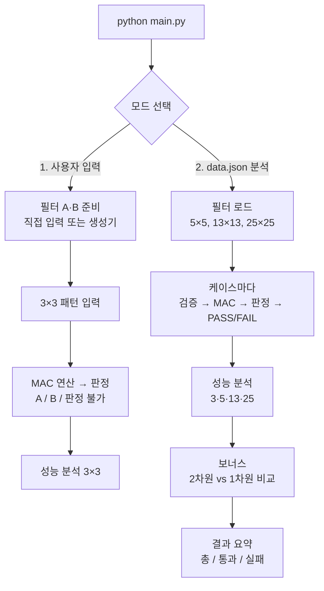
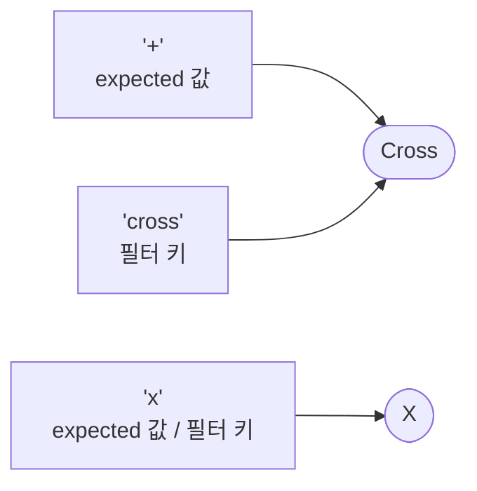
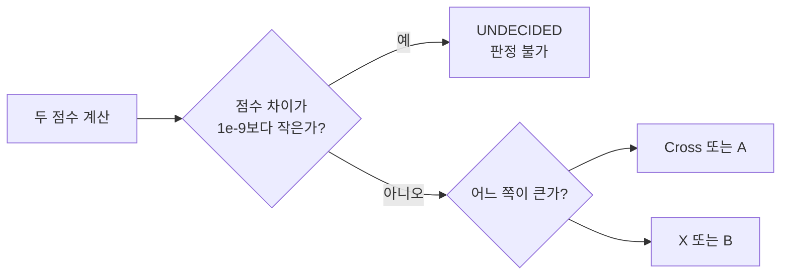
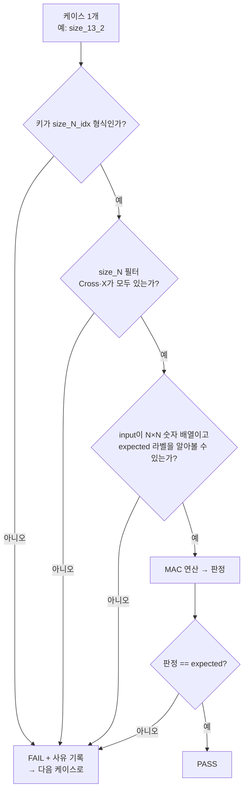
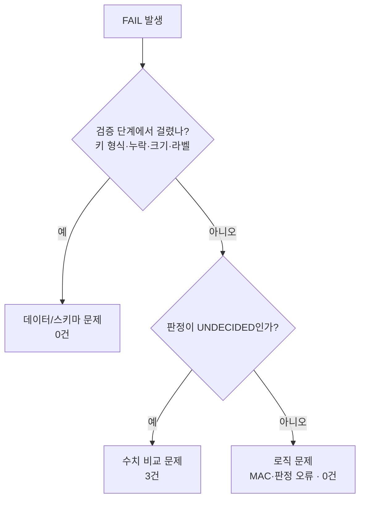
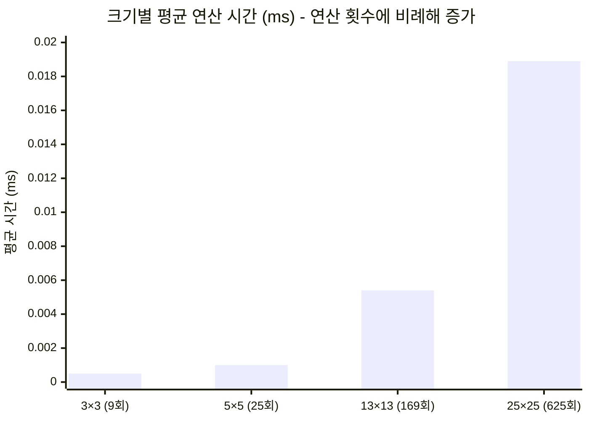
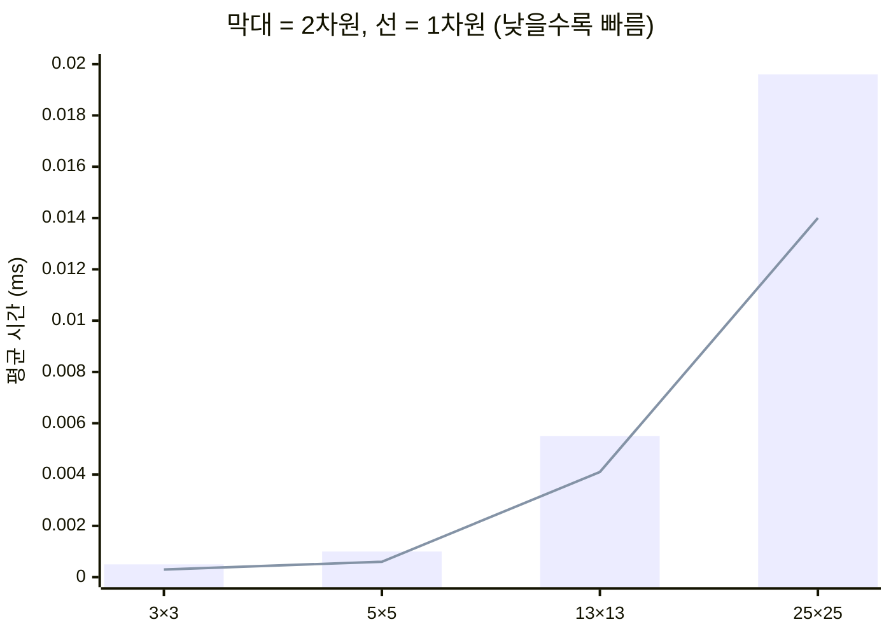
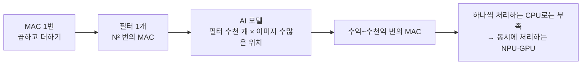

# Mini NPU Simulator — What is MAC?

MAC(Multiply-Accumulate) 연산으로 N×N 패턴이 **십자가(Cross)** 인지 **X** 인지 판별하는 Python 콘솔 프로그램입니다.
외부 라이브러리 없이 표준 라이브러리(`json`, `time`, `re`, `os`)만 사용합니다.

## 0. 한눈에 보기

**왜 이 과제를 하나?** AI는 결국 "곱하고 더하기(MAC)"를 수억~수천억 번 반복하는 계산입니다. 이 프로그램은 그 MAC을 직접 만들어 보고, 크기가 커질수록 계산량이 얼마나 빠르게 늘어나는지 재보는 작은 실험입니다. (결론은 [5번](#5-이-미션에서-중요하게-본-점))

> 그림을 숫자 배열로 바꾸고 → 기준 그림(필터)과 **같은 칸끼리 곱해서 더하면(MAC)** → 점수가 높은 쪽이 정답입니다.



**읽기 전에 알아두면 좋은 용어**

| 용어 | 쉬운 뜻 |
|---|---|
| 필터 | 비교 기준이 되는 그림 (십자가 모양, X 모양) |
| 스키마 | 데이터가 지켜야 할 형식 규칙 (예: `input`은 N×N 숫자 배열) |
| 정규화 | 같은 뜻의 다른 표기(`'+'`, `'cross'`)를 하나(`Cross`)로 통일하는 것 |
| epsilon | "이 정도 차이는 같은 걸로 본다"는 허용 오차 (여기선 0.000000001) |
| O(N²) | 크기 N이 2배가 되면 걸리는 시간이 약 4배가 된다는 뜻 |
| I/O | 입력·출력·파일 읽기. 계산 시간만 재려고 측정에서 뺌 |

---

## 1. 실행 방법

```bash
python main.py
```

- Python 3.8 이상
- `data.json`은 `main.py`와 **같은 폴더**에 두면 됩니다. (실행 위치와 무관하게 `main.py` 기준으로 찾음)

```
[모드 선택]
1. 사용자 입력 (3x3)   → 필터 A·B, 패턴을 입력해 판정
2. data.json 분석      → 파일의 모든 케이스를 일괄 판정 + 성능 분석 + 결과 요약
```

모드 1에서는 필터 입력 방식을 고를 수 있습니다.
```
필터 입력 방식 (1: 직접 입력, 2: 패턴 생성기로 자동 생성)
→ 2를 고르면 필터 A = 3×3 십자가, 필터 B = 3×3 X가 자동으로 들어갑니다.
```
(자동 생성은 보너스 과제인 패턴 생성기를 활용한 기능입니다 → [2-5](#2-5-보너스-패턴-생성기))

입력 예시 (모드 1): 한 줄에 숫자 3개를 공백으로 구분해 입력
```
0 1 0
1 1 1
0 1 0
```

---

## 2. 구현 요약

### 2-1. MAC 연산
```python
for i in range(n):
    for j in range(n):
        total += pattern[i][j] * filt[i][j]
```
두 배열을 겹쳐 **같은 위치끼리 곱하고(Multiply) 모두 더한다(Accumulate)**. 둘 다 값이 있는 칸이 많을수록 점수가 높아지므로, 점수 = "패턴과 필터가 닮은 정도"가 됩니다.

```
 십자가 패턴      십자가 필터       같은 칸끼리 곱함
  0 1 0           0 1 0             0 1 0
  1 1 1     ×     1 1 1     →       1 1 1     →  모두 더하면 5점 (잘 맞음)
  0 1 0           0 1 0             0 1 0

 십자가 패턴        X 필터          같은 칸끼리 곱함
  0 1 0           1 0 1             0 0 0
  1 1 1     ×     0 1 0     →       0 1 0     →  모두 더하면 1점 (안 맞음)
  0 1 0           1 0 1             0 0 0
```
NumPy 없이 이중 반복문으로 직접 구현했습니다.

### 2-2. 라벨 정규화
데이터 안에서 같은 의미가 서로 다르게 표기되어 있습니다.



정규화 없이 비교하면 `'+' == 'Cross'`가 거짓이 되어, 판정이 맞아도 FAIL이 납니다.
그래서 데이터를 읽는 즉시 `LABEL_MAP`으로 변환하고(대소문자·앞뒤 공백도 정리), 출력과 PASS/FAIL 비교는 모두 표준 라벨로만 수행합니다.

### 2-3. 동점 처리 정책 (epsilon)
```python
if abs(score_a - score_b) < 1e-9:  →  UNDECIDED (판정 불가)
```
컴퓨터는 소수를 2진수로 저장하므로 `0.1 + 0.2 = 0.30000000000000004`처럼 미세한 오차가 생깁니다.
`==`나 `>`로 바로 비교하면 **사실상 같은 점수인데 오차 때문에 한쪽이 이긴 것으로** 판정됩니다. 차이가 1e-9보다 작으면 동점으로 간주합니다.
→ 실제로 data.json에서 이 일이 **3건** 일어났습니다. ([3-2 실패 원인 분석](#3-2-실패-원인-분석) 참고)



### 2-4. 입력/데이터 검증
- **모드 1**: 숫자 개수가 3개가 아니거나 숫자로 변환할 수 없으면 안내 후 **그 줄만 재입력**.
- **모드 2**: `filters`/`patterns` 섹션 형식(객체인지), 키 형식(`size_N_idx`), 필터 존재 여부, input/expected 누락, 행·열 수, 숫자 여부를 검사.
  문제가 있으면 프로그램을 멈추지 않고 **해당 케이스만 FAIL + 사유 기록** 후 다음 케이스로 진행.



### 2-5. 보너스: 패턴 생성기

**왜 필요한가?**
- **손으로 만들 수 없는 입력을 만든다**: 25×25 패턴은 숫자 625개입니다. 크기 N만 정하면 십자가와 X를 자동으로 만들어 주는 "테스트 데이터 공장" 역할을 합니다.
- **공정한 비교를 위해**: 성능을 잴 때 모든 크기에서 같은 모양(십자가 × X)을 써야, 시간이 달라진 이유가 **크기 하나 때문**이라고 말할 수 있습니다. (실험의 "통제 변인")

**구현**
- `make_cross(N)`: 가운데 행 + 가운데 열을 1로 채움
- `make_x(N)`: 두 대각선(`i == j`, `i + j == N-1`)을 1로 채움
- **모드 1에서 재사용**: 필터를 직접 입력하는 대신 생성기로 자동 생성할 수 있음.
- **성능 분석에서 재사용**: data.json에 없는 3×3을 포함해 **모든 크기를 동일 조건으로 측정**.

### 2-6. 보너스: 1차원 배열 최적화

**왜 필요한가?**
- 미션에서 이 보너스의 이름은 "**메모리 접근** 최적화"입니다. 실제 컴퓨터 메모리는 칸이 한 줄로 늘어선 구조라서, 데이터를 한 줄로 이어 붙여 두면 한꺼번에 빠르게 읽어올 수 있습니다.
- NPU·GPU가 빠른 이유는 계산이 빨라서만이 아니라 **필요한 데이터를 빨리 가져오기 때문**이기도 합니다. 2차원 → 1차원 변환은 그 생각을 작게 체험해 보는 실험입니다.

**구현**
- `flatten(m)`: N×N 배열을 길이 N²의 1차원 배열로 폄 (i행 j열 → 인덱스 `i*N + j`).
- `mac_flat(a, b)`: 이중 반복문 대신 **반복문 하나**로 N²번 곱하고 더함.

```
 2차원 (3×3)                         1차원 (길이 9)
  [a b c]
  [d e f]     ── flatten ──▶     [a b c d e f g h i]
  [g h i]

 pattern[1][2] = f                 a[1×3 + 2] = a[5] = f
 (1번 행을 꺼내고 → 그 안에서 2번째)   (바로 5번째 칸)
```
- 2차원 `mac`과 결과 점수가 완전히 같음을 data.json 전체 케이스로 확인.
- 펼치는 작업(`flatten`)은 측정 구간 밖에서 1번만 수행하고, **같은 입력·같은 반복 횟수(10회)**로 두 함수의 연산 시간만 비교.

> ⚠️ **한계**: 파이썬 리스트는 숫자를 메모리에 실제로 이어 붙여 저장하지 않습니다(각 칸이 숫자가 있는 위치를 가리키는 방식). 그래서 이 실험에서 빨라진 이유는 "연속 메모리"보다는 **값을 찾아가는 횟수가 2번 → 1번으로 줄어든 것**입니다. C 언어나 실제 칩에서는 연속 메모리 효과가 훨씬 크게 나타납니다.

---

## 3. 결과 리포트

### 3-1. data.json 실행 결과

| 케이스 | Cross 점수 | X 점수 | 판정 | expected | 결과 |
|---|---|---|---|---|---|
| size_5_1 | 0.9 | 0.8999999999999999 | UNDECIDED | X | **FAIL** |
| size_5_2 | 8.9 | 0.1 | Cross | Cross | PASS |
| size_13_1 | 0.3 | 14.700000000000008 | X | X | PASS |
| size_13_2 | 7.499999999999997 | 7.5 | UNDECIDED | Cross | **FAIL** |
| size_25_1 | 4.9 | 4.899999999999999 | UNDECIDED | X | **FAIL** |
| size_25_2 | 52.9 | 0.1 | Cross | Cross | PASS |

**총 6개 / 통과 3개 / 실패 3개**

### 3-2. 실패 원인 분석

실패 원인을 아래 순서로 따라가며 세 가지로 분류했습니다.



**① 데이터/스키마 문제가 0건인 이유**
라벨 정규화(`'+'`→Cross, `'x'`→X)로 표기 차이를 흡수했고, 모든 패턴의 크기가 키의 N과 일치했습니다.
(의도적으로 망가뜨린 데이터로 별도 테스트한 결과, 크기 불일치·필드 누락·없는 필터·숫자 아닌 값·키 형식 오류 모두 케이스 단위 FAIL로 처리되고 프로그램은 정상 종료됨을 확인했습니다.)

**② 실패 3건의 원인 = 필터 가중치 설계상 수학적으로 정확한 동점**
data.json의 필터는 모든 칸이 1인 단순 필터가 아니라, 칸마다 가중치가 다르게 들어 있습니다.

| 케이스 | Cross 필터와 겹친 결과 | X 필터와 겹친 결과 | 수학적 값 |
|---|---|---|---|
| size_5_1 (X 패턴) | 가운데 1칸만 겹침 → 0.9 | 대각선 9칸 × 0.1 | **0.9 = 0.9** |
| size_13_2 (Cross 패턴) | 십자 25칸 × 0.3 | 가운데 1칸만 겹침 → 7.5 | **7.5 = 7.5** |
| size_25_1 (X 패턴) | 가운데 1칸만 겹침 → 4.9 | 대각선 49칸 × 0.1 | **4.9 = 4.9** |

수학적으로는 완전히 같은 점수입니다. 하지만 0.1, 0.3은 2진수로 정확히 표현할 수 없어서, 여러 번 더하는 동안 오차가 쌓여 끝자리가 달라집니다(차이: 약 1e-16 ~ 3e-15).
epsilon(1e-9) 정책이 이 차이를 동점으로 올바르게 인식했고, 동점은 규칙상 UNDECIDED로 판정되므로 expected와 달라 FAIL이 되었습니다.

**③ epsilon이 없었다면? → 더 위험한 "조용한 오답"**
같은 3건을 단순 `>` 비교로 판정해 보면:

| 케이스 | 단순 `>` 판정 | expected |
|---|---|---|
| size_5_1 | Cross | X |
| size_13_2 | X | Cross |
| size_25_1 | Cross | X |

세 건 모두 **정답의 반대로** 판정됩니다. 결과는 똑같이 FAIL이지만, 이 경우 프로그램은 "확신을 가지고 틀린 답"을 내고 원인도 드러나지 않습니다.
반면 epsilon 정책은 "판단할 수 없음"을 명시적으로 알려주므로, 원인이 **로직이 아니라 수치 비교 문제**임을 바로 진단할 수 있습니다.

**④ 결론 및 개선 방향**
- 현재 FAIL 3건은 로직 결함이 아니라 **"동점은 UNDECIDED" 정책을 정확히 지킨 결과**입니다.
- expected 라벨은 동점이 아닌 상황을 가정하고 붙어 있어 정책과 충돌합니다. 개선하려면 (a) 동점이 나지 않도록 필터 가중치를 재설계하거나, (b) 동점 시 우선순위 규칙(tie-breaker)을 별도로 정의해야 합니다.
- 오차를 이유로 epsilon을 제거하거나, FAIL을 없애려고 임의로 한쪽을 고르는 것은 근거 없는 판정이 되므로 채택하지 않았습니다.

### 3-3. 성능 분석 및 시간 복잡도

측정 조건: 패턴 생성기로 만든 Cross 패턴 × X 필터, 크기별 MAC 10회 반복 평균, I/O 제외하고 연산 함수 호출 구간만 `time.perf_counter()`로 측정.

| 크기 | 평균 시간(ms) | 연산 횟수(N²) | 곱셈 1회당 시간(μs) |
|---|---|---|---|
| 3×3 | 0.0005 | 9 | 0.055 |
| 5×5 | 0.0010 | 25 | 0.040 |
| 13×13 | 0.0054 | 169 | 0.032 |
| 25×25 | 0.0189 | 625 | 0.030 |

(측정 환경에 따라 절대값은 달라질 수 있으며, 3회 반복 실행 시 값이 거의 동일했습니다.)



**① 코드 구조 근거**: MAC은 이중 반복문(행 N번 × 열 N번)이므로 곱셈·덧셈을 정확히 **N²번** 수행합니다 → **O(N²)**.

**② 측정 근거**: N이 커질수록 전체 시간은 증가하지만, **곱셈 1회당 시간은 크기가 커질수록 약 0.03μs로 수렴**합니다(13×13, 25×25에서 거의 같음). 1회당 비용이 일정해진다는 것은 전체 시간이 연산 횟수(N²)에 비례한다는 뜻으로, O(N²)을 실측으로 뒷받침합니다.
예) 13×13 → 25×25: 연산 횟수 169 → 625 (약 3.7배), 시간 0.0054 → 0.0189ms (약 3.5배)

**③ 작은 크기에서 1회당 시간이 더 큰 이유**: 함수 호출, 반복문 준비 같은 **고정 비용**이 있기 때문입니다. 연산이 9번뿐인 3×3에서는 이 고정 비용 비중이 크고, 625번인 25×25에서는 거의 묻혀서 순수 연산 비용(N²)이 드러납니다.

**④ 의미**: 크기가 2배가 되면 연산은 4배, 10배가 되면 100배가 됩니다. 그렇다면 이 늘어나는 계산을 어떻게 빠르게 할 수 있을까요? → 3-4에서 한 가지 방법(1차원 최적화)을 시도해 봤습니다.

### 3-4. 보너스: 최적화 전/후 비교 (2차원 vs 1차원)

| 크기 | 2차원(ms) | 1차원(ms) | 속도 향상 |
|---|---|---|---|
| 3×3 | 0.0005 | 0.0003 | 약 1.6배 |
| 5×5 | 0.0010 | 0.0006 | 약 1.7배 |
| 13×13 | 0.0055 | 0.0041 | 약 1.3배 |
| 25×25 | 0.0196 | 0.0140 | 약 1.4배 |

(여러 번 실행하면 배율은 약 1.1~2배 사이에서 흔들리지만, 1차원이 더 느린 경우는 없었습니다.)
(이 표의 2차원 값은 3-3과 별도로 다시 잰 값이라 조금 다릅니다. 예: 25×25에서 0.0189 vs 0.0196. 같은 계산도 잴 때마다 이 정도는 흔들린다는 뜻이고, 아래 ③의 이유와 같습니다.)



**① 왜 빨라지나**: 2차원 `pattern[i][j]`는 "i번째 행 리스트를 꺼낸 뒤 → 그 안에서 j번째 값"으로 **두 번 찾아가야** 합니다. 1차원 `a[k]`는 **한 번에** 찾아가고, 반복문도 하나라 반복문을 준비하는 비용도 줄어듭니다.

**② 시간 복잡도는 그대로**: 둘 다 곱셈을 정확히 N²번 하므로 **O(N²)**입니다. 최적화로 줄어든 것은 연산 횟수가 아니라 **값 1개를 꺼내는 비용(상수)**입니다. 크기가 커질수록 시간이 N²에 비례해 늘어나는 모양은 같습니다.

**③ 측정값이 흔들리는 이유**: 연산 1번이 수 마이크로초(μs) 수준이라, 10회 반복으로는 운영체제의 다른 작업이 끼어드는 영향이 상대적으로 큽니다. 그래서 정확한 배율보다는 "1차원이 항상 더 빠르다"는 방향을 결론으로 삼았습니다.

**④ 최적화의 한계 → 결론으로**: 값 꺼내는 방법을 다듬어도 빨라진 건 약 1.4배였고, 계산 횟수(N²)는 그대로였습니다. 크기가 10배가 되면 계산은 100배가 되는데, 1.4배 개선으로는 따라잡을 수 없습니다. 그래서 필요한 것이 **여러 계산을 동시에 처리하는 방식**입니다. → [5번](#5-이-미션에서-중요하게-본-점)

---

## 4. 재현성 체크

| 항목 | 방법 | 기대 결과 |
|---|---|---|
| 모드 1 정상 | 필터 A=십자가, B=X, 패턴=X 입력 | A 1.0 / B 5.0 → 판정 B |
| 모드 1 생성기 | 필터 입력 방식에서 2 선택, 패턴=X 입력 | 위와 동일 (A 1.0 / B 5.0 → 판정 B) |
| 모드 1 동점 | 필터 A 첫 줄 `0.1 0.2 0`, 필터 B 첫 줄 `0.3 0 0`, 패턴 첫 줄 `1 1 0` (나머지 줄은 모두 `0 0 0`) | A 0.30000000000000004 / B 0.3 → 판정 불가 |
| 모드 1 오류 입력 | `0 1`, `1 0 1 1`, `0 a 0` | 안내 문구 후 해당 줄 재입력 |
| 모드 2 | `python main.py` → 2 | 총 6 / 통과 3 / 실패 3, 실패 사유 출력 |
| 모드 2 이상한 데이터 | `filters`/`patterns`를 리스트로 바꾸거나 JSON 문법을 깨뜨림 | 오류 메시지 출력 후 총 0개로 정상 종료 |

---

## 5. 이 미션에서 중요하게 본 점

### AI가 하는 일은 결국 "곱하고 더하기"의 반복이다

이번에 만든 MAC은 "같은 칸끼리 곱해서 모두 더하기"라는 아주 단순한 계산입니다.
그런데 챗GPT 같은 거대한 AI도 내부를 들여다보면, 이 계산을 **수천억 번 반복**하는 것이 대부분입니다.
즉 AI의 핵심은 어려운 계산 하나가 아니라, **쉬운 계산을 엄청나게 많이 하는 것**입니다.



이 과제의 성능 분석에서 이 점을 직접 확인했습니다.
- 3×3 → 25×25로 크기가 커지자 연산 횟수가 9번 → 625번(약 70배)으로 늘었고, 시간도 함께 늘었습니다. 13×13 → 25×25 구간에서는 연산 3.7배, 시간 3.5배로 거의 같은 비율이었습니다(O(N²)).
- 1차원 최적화로 값을 꺼내는 비용을 줄여도 약 1.4배 빨라질 뿐, **연산 횟수 자체는 그대로**였습니다.

결국 계산 하나하나를 빠르게 다듬는 데는 한계가 있고, 큰 차이는 **여러 개를 동시에(병렬로) 처리하는 것**에서 나옵니다.
CPU가 계산을 하나씩 처리하는 반면 NPU는 수천 개의 MAC을 한 번에 처리하도록 만들어진 칩이고, 이것이 AI 전용 반도체가 필요한 이유입니다.
