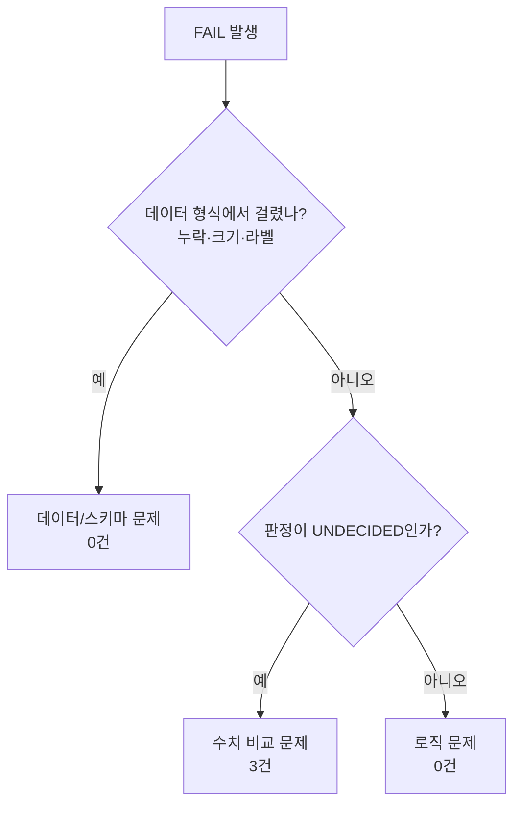
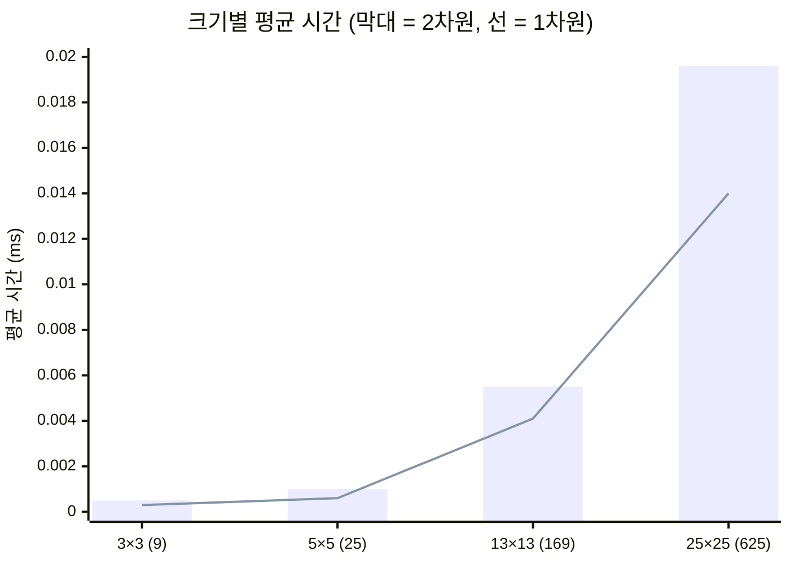
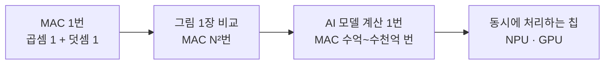

# Mini NPU Simulator — What is MAC?

그림이 **십자가(Cross)** 인지 **X** 인지 컴퓨터가 판별하게 만드는 Python 콘솔 프로그램입니다.
외부 라이브러리 없이 표준 라이브러리(`json`, `time`, `re`, `os`)만 사용합니다.

---

## 1. 한눈에 보기

**왜 이 과제를 하나?** AI 계산의 대부분은 "곱하고 더하기(MAC)"를 수억~수천억 번 반복하는 것입니다. 이 프로그램은 그 MAC을 직접 만들어 보고, 그림이 커질수록 계산이 얼마나 늘어나는지 재보는 작은 실험입니다.

**어떻게 판별하나?** 그림을 0과 1로 바꾸고, 기준 그림(필터)과 **같은 칸끼리 곱해서 모두 더합니다.** 점수가 더 높은 필터 쪽이 정답입니다.

```
 십자가 그림      십자가 필터       같은 칸끼리 곱함
  0 1 0           0 1 0             0 1 0
  1 1 1     ×     1 1 1     →       1 1 1     →  모두 더하면 5점 (잘 맞음)
  0 1 0           0 1 0             0 1 0

 십자가 그림        X 필터          같은 칸끼리 곱함
  0 1 0           1 0 1             0 0 0
  1 1 1     ×     0 1 0     →       0 1 0     →  모두 더하면 1점 (안 맞음)
  0 1 0           1 0 1             0 0 0
```
→ 5점 > 1점이므로 "십자가"로 판정합니다.

| 용어 | 쉬운 뜻 |
|---|---|
| MAC | 곱셈 1번 + 덧셈 1번. 3×3 그림 하나를 비교하면 MAC을 9번 하게 됨 |
| 필터 / 가중치 | 필터 = 비교 기준 그림. 가중치 = 필터 각 칸에 적힌 숫자(중요도) |
| expected | data.json에 적혀 있는 정답. 판정과 같으면 PASS, 다르면 FAIL |
| 정규화 | 같은 뜻의 다른 표기(`'+'`, `'cross'`)를 하나(`Cross`)로 통일하는 것 |
| 스키마 | 데이터가 지켜야 할 형식 규칙 (예: 그림은 N×N 숫자 배열) |
| epsilon | "이 정도 차이는 같은 걸로 본다"는 허용 오차 (여기선 0.000000001) |
| O(N²) | 그림 한 변(N)이 2배가 되면 계산량이 4배가 된다는 뜻 |

---

## 2. 실행 방법

```bash
python main.py
```
- Python 3.8 이상, `data.json`은 `main.py`와 같은 폴더에 둡니다.
- **모드 1 (사용자 입력)**: 3×3 필터 2개와 그림을 한 줄씩 입력 (예: `0 1 0`). 필터는 직접 입력하거나 자동 생성(십자가·X)을 고를 수 있습니다.
- **모드 2 (data.json 분석)**: 파일의 모든 그림을 한 번에 판정 → 성능 측정 → 결과 요약을 출력합니다.

---

## 3. 구현 요약

### 3-1. MAC 연산
쉽게 말하면, 1장의 그림처럼 **같은 칸끼리 곱하고 전부 더하는** 것을 반복문으로 직접 구현했습니다. (NumPy 같은 도구 없이)
```python
for i in range(n):          # 줄
    for j in range(n):      # 칸
        total += pattern[i][j] * filt[i][j]
```

<details>
<summary>전공자용 보충</summary>

- MAC은 하드웨어 기준으로 "곱셈 1번 + 누적 덧셈 1번"이고, `mac()` 함수 1번 호출은 N²번의 MAC입니다.
- 점수는 크기 조정(정규화)을 하지 않은 내적(dot product)입니다. 칠해진 칸이 많은 그림은 어떤 필터와 비교해도 점수가 커지므로, 이 점수는 **두 필터 점수를 서로 비교할 때만** 의미가 있습니다.
</details>

### 3-2. 라벨 정규화
data.json 안에서 같은 뜻이 다르게 적혀 있습니다. (`'+'`, `'cross'` → **Cross** / `'x'` → **X**)
통일하지 않으면 컴퓨터는 `'+'`와 `'Cross'`를 다른 값으로 보고, 판정이 맞아도 FAIL을 냅니다. 그래서 데이터를 읽자마자 표준 라벨로 바꾼 뒤 비교합니다.

### 3-3. 동점 처리 (epsilon)
컴퓨터는 소수를 2진수로 저장해서 작은 오차가 생깁니다. 예를 들어 `0.1 + 0.2`가 정확히 `0.3`이 아니라 `0.30000000000000004`가 됩니다.
그래서 **두 점수 차이가 0.000000001보다 작으면 같은 점수(판정 불가, UNDECIDED)** 로 봅니다.

> 체중계에 60kg과 59.9999999kg이 찍혔다면 같은 몸무게로 보는 게 맞습니다. 억지로 "60kg이 더 무겁다"고 판정하는 쪽이 틀린 판정입니다.

```python
if abs(score_a - score_b) < 1e-9:  →  UNDECIDED
```

### 3-4. 입력 검증
- **모드 1**: 한 줄에 숫자가 3개가 아니거나 숫자가 아닌 값이 있으면 안내 후 **그 줄만 다시 입력**받습니다.
- **모드 2**: 형식이 잘못된 데이터가 있어도 프로그램을 멈추지 않고 **그 그림만 FAIL + 이유 기록** 후 다음으로 넘어갑니다. (키 형식, 필터 존재, 누락, 크기, 숫자 여부 검사)

### 3-5. 보너스: 패턴 생성기
크기 N만 정하면 십자가와 X 그림을 자동으로 만듭니다. (`make_cross`, `make_x`)
- **왜 필요한가**: 25×25 그림은 숫자가 625개라 손으로 입력할 수 없습니다. 또 성능을 잴 때 모든 크기에서 **같은 모양**을 써야 "시간 차이는 크기 때문"이라고 말할 수 있습니다.
- **어디에 쓰나**: 모드 1의 필터 자동 생성, 성능 측정용 입력

### 3-6. 보너스: 1차원 배열 최적화
2차원 그림을 한 줄(1차원)로 펴서 계산합니다. (`flatten`, `mac_flat`)

```
 2차원 (3×3)                      1차원 (9칸)
  a b c
  d e f      ── 한 줄로 펴기 ──▶     a b c d e f g h i
  g h i

 "1번 줄의 2번 칸" = f               "5번 칸" = f
 줄 찾고 → 칸 찾고 (2번 이동)         바로 찾기 (1번 이동)

 ※ 컴퓨터는 번호를 0부터 셉니다. (0번 = 첫 번째)
```
- **왜 필요한가**: "3번 책장의 5번째 칸"보다 "한 줄로 늘어선 책 중 23번"이 더 빨리 찾아집니다. 실제 NPU·GPU도 계산 자체만큼 **필요한 데이터를 빨리 가져오는 것**이 속도에 중요합니다.
- 결과 점수는 2차원 방식과 완전히 같음을 확인했습니다.

<details>
<summary>전공자용 보충</summary>

- 미션의 원래 이름은 "메모리 접근 최적화"입니다. 핵심은 차원 수가 아니라 **데이터가 메모리에 연속으로 놓여 있고, 그 순서대로 읽느냐**입니다. (C의 2차원 배열은 원래 연속 저장됨)
- 파이썬의 리스트 안의 리스트는 행마다 메모리에 흩어져 있고, 리스트는 숫자 자체가 아니라 숫자의 위치(포인터)를 저장합니다. 따라서 이번에 빨라진 주된 이유는 연속 메모리 효과보다 **인덱싱 횟수 감소와 반복문 1개로 줄어든 비용**입니다.
- `flatten`은 측정 구간 밖에서 1번만 실행하고, 같은 입력·같은 반복 횟수(10회)로 비교했습니다.
</details>

---

## 4. 결과 리포트

### 4-1. data.json 실행 결과

| 그림 | Cross 점수 | X 점수 | 판정 | 정답(expected) | 결과 |
|---|---|---|---|---|---|
| size_5_1 | 0.9 | 0.8999999999999999 | UNDECIDED | X | **FAIL** |
| size_5_2 | 8.9 | 0.1 | Cross | Cross | PASS |
| size_13_1 | 0.3 | 14.700000000000008 | X | X | PASS |
| size_13_2 | 7.499999999999997 | 7.5 | UNDECIDED | Cross | **FAIL** |
| size_25_1 | 4.9 | 4.899999999999999 | UNDECIDED | X | **FAIL** |
| size_25_2 | 52.9 | 0.1 | Cross | Cross | PASS |

**총 6개 / 통과 3개 / 실패 3개**

### 4-2. 실패 원인 분석

미션이 제시한 세 가지 원인 중 어디에 해당하는지 아래 순서로 따라가 봤습니다.



**① 3건 모두 "수학적으로는 정확한 동점"입니다.**
data.json의 필터는 칸마다 가중치가 다르게 들어 있어서, 계산해 보면 두 점수가 똑같이 나옵니다.

| 그림 | Cross 필터 점수 | X 필터 점수 |
|---|---|---|
| size_5_1 | 가운데 1칸 × 0.9 = **0.9** | 대각선 9칸 × 0.1 = **0.9** |
| size_13_2 | 십자 25칸 × 0.3 = **7.5** | 가운데 1칸 × 7.5 = **7.5** |
| size_25_1 | 가운데 1칸 × 4.9 = **4.9** | 대각선 49칸 × 0.1 = **4.9** |

그런데 0.1, 0.3 같은 소수는 2진수로 정확히 표현되지 않아서, 여러 번 더하는 동안 소수점 아래 15~16번째 자리에 아주 작은 오차가 생겼습니다.
epsilon 규칙이 이를 "같은 점수"로 올바르게 인식해 UNDECIDED로 판정했습니다.

**② epsilon이 없었다면 세 건 모두 정답의 반대로 판정됩니다.**
오차 때문에 0.9가 0.8999…보다 "크다"고 보고 Cross를 고르는 식입니다. 결과는 똑같이 FAIL이지만, 이 경우 프로그램은 **틀린 답을 확신하며 내놓고** 원인도 드러나지 않습니다. epsilon 덕분에 "판단할 수 없음"이 드러나서, 원인이 로직이 아니라 **수치 비교 문제**임을 바로 알 수 있었습니다.

**③ 결론**
- 정답(expected)에는 Cross와 X만 있고 UNDECIDED가 없으므로, 정확한 동점인 그림은 **규칙상 PASS할 수 없습니다.** 미션 예시도 동점은 FAIL로 처리합니다.
- FAIL을 없애려고 epsilon을 빼거나 한쪽을 임의로 고르면 근거 없는 판정이 되므로 그렇게 하지 않았습니다. 개선하려면 동점이 나지 않게 필터 가중치를 바꾸거나, 동점일 때의 우선순위 규칙을 따로 정해야 합니다.

### 4-3. 성능 분석과 시간 복잡도

같은 모양(생성기로 만든 십자가 그림 × X 필터)으로 크기만 바꿔, 계산 부분만 10번씩 재서 평균을 냈습니다.

| 크기 | 계산 횟수(N²) | 평균 시간(ms) | 1차원 방식(ms) |
|---|---|---|---|
| 3×3 | 9 | 0.0005 | 0.0003 |
| 5×5 | 25 | 0.0010 | 0.0006 |
| 13×13 | 169 | 0.0055 | 0.0041 |
| 25×25 | 625 | 0.0196 | 0.0140 |


(측정값은 실행할 때마다 조금씩 달라집니다.)

**① 왜 O(N²)인가**: 바둑판의 한 변이 2배가 되면 칸 수는 4배가 됩니다. MAC도 모든 칸을 한 번씩 곱하므로 계산 횟수가 정확히 N²입니다.

**② 측정으로 확인**: 13×13 → 25×25에서 계산 횟수는 약 3.7배, 시간은 약 3.6배 늘었습니다. 계산 횟수와 시간이 같은 비율로 늘어난 것이 O(N²)의 근거입니다.

**③ 작은 크기에서는 비율이 안 맞는 이유**: 계산 외에 함수를 부르는 등의 기본 비용이 있어서, 계산이 9번뿐인 3×3에서는 그 비용이 상대적으로 크게 보입니다. 크기가 커질수록 이 영향은 묻힙니다.

**④ 1차원 최적화의 효과와 한계**: 1차원 방식이 약 1.3~1.7배 빨랐습니다(실행마다 조금씩 다르지만 더 느린 적은 없음). 하지만 계산 횟수(N²)는 그대로라서, 크기가 10배가 되면 시간은 여전히 약 100배가 됩니다. **방법을 다듬는 것만으로는 늘어나는 계산량을 따라잡을 수 없습니다.** → 6번 결론으로 이어집니다.

<details>
<summary>전공자용 보충</summary>

- 여기서 N은 한 변의 길이입니다. 입력 칸 수(M = N²) 기준으로 보면 MAC은 O(M), 즉 칸 수에 선형입니다.
- "2배 → 4배"는 N이 충분히 클 때의 경향입니다. 작은 N에서는 고정 비용(함수 호출, `range` 생성) 비중이 커서, 곱셈 1회당 시간이 3×3에서 약 0.056μs, 25×25에서 약 0.031μs로 수렴합니다.
- 측정은 `time.perf_counter()`로 MAC 함수 호출 구간만 재고 입출력은 제외했습니다. 한 번의 호출이 수 μs 이하라 운영체제의 다른 작업에 따라 값이 흔들리므로, 정확한 배율보다 방향(경향)을 결론으로 삼았습니다.
- epsilon은 절대 오차(1e-9) 기준입니다. 점수 규모가 매우 커지면 상대 오차 기준(`math.isclose`)이 더 적합할 수 있습니다.
</details>

---

## 5. 재현성 체크

| 확인할 것 | 방법 | 기대 결과 |
|---|---|---|
| 모드 1 기본 | 필터 A=십자가, B=X (또는 자동 생성), 그림=X | A 1.0 / B 5.0 → 판정 B |
| 모드 1 동점 | 필터 A 첫 줄 `0.1 0.2 0`, 필터 B 첫 줄 `0.3 0 0`, 그림 첫 줄 `1 1 0` (나머지 줄은 `0 0 0`) | 판정 불가 |
| 모드 1 잘못된 입력 | `0 1`, `0 a 0` 입력 | 안내 후 그 줄 다시 입력 |
| 모드 2 | `python main.py` → 2 | 총 6 / 통과 3 / 실패 3 |
| 모드 2 깨진 파일 | data.json 형식을 일부러 망가뜨림 | 오류 안내 후 멈추지 않고 종료 |

---

## 6. 이 미션에서 중요하게 본 점

### AI 계산의 대부분은 "곱하고 더하기"의 반복이다

이번에 만든 MAC은 같은 칸끼리 곱해서 더하는 아주 단순한 계산입니다. 그런데 챗GPT 같은 거대한 AI도 계산의 대부분은 이것을 **수천억 번 반복**하는 것입니다. AI의 핵심은 어려운 계산 하나가 아니라, **쉬운 계산을 엄청나게 많이 하는 것**입니다.



이 과제에서 직접 확인한 것도 같습니다. 그림이 커지면 계산이 N²으로 늘어났고, 1차원 최적화로 방법을 다듬어도 1.3~1.7배 빨라지는 데 그쳤습니다.

> 은행 창구 1개를 아무리 빠르게 만들어도, 손님이 수천 명이면 창구를 수천 개 여는 쪽이 압도적으로 빠릅니다.

CPU는 한 번에 처리하는 계산이 수~수십 개 수준이지만, NPU는 **수천 개의 MAC을 동시에** 처리하도록 만든 칩입니다. 이것이 AI 전용 반도체가 필요한 이유입니다.
